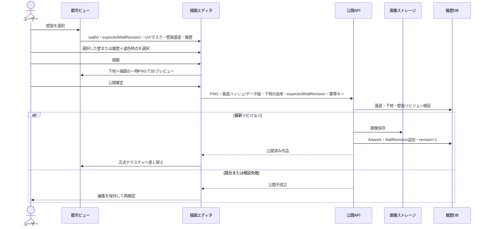
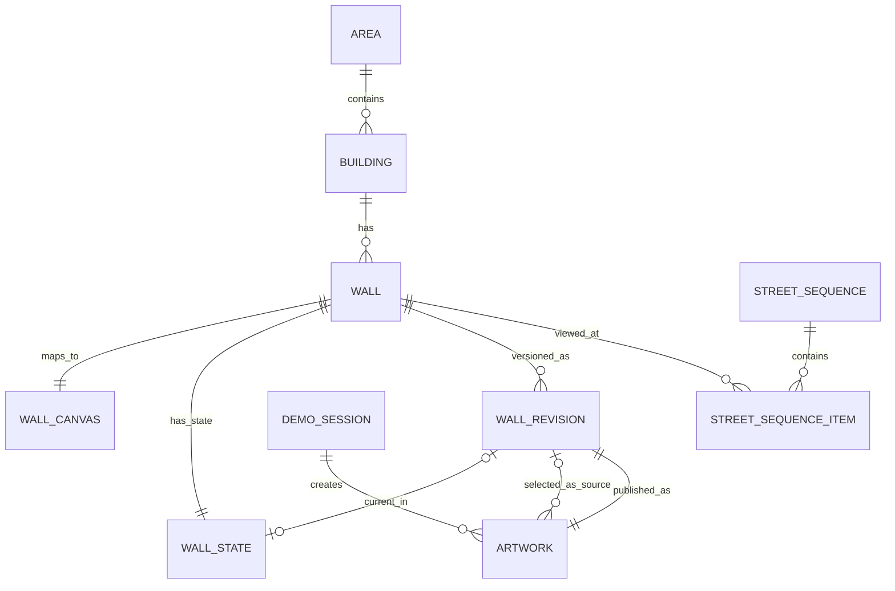

# OpenGraffiti 要件定義書

作成日: 2026-07-05  
最終更新日: 2026-07-25  
ステータス: 決定版（MVP要件確定）  

参考資料:

- [プロジェクトルート README](../../README.md)
- [コンセプト資料](../../コンセプト/README.md)
- [PLATEAU公式：LODレベルによる表現の違い](https://www.mlit.go.jp/plateau/learning/tpc03-3/)
- [PLATEAU公式：CityGMLの座標・高さとデータ変換](https://www.mlit.go.jp/plateau/learning/tpc03-4/)
- [PLATEAU公式：Three.jsで3D都市モデルを表示する](https://www.mlit.go.jp/plateau/learning/tpc12-1/)
- [PLATEAU公式：PLATEAU GIS Converter](https://www.mlit.go.jp/plateau/learning/tpc30/)
- [PLATEAU公式：PLATEAU-2D紹介記事](https://www.mlit.go.jp/plateau/journal/j0101/)

> **資料の位置付け**  
> コンセプト資料は将来像を含む。本書に明記したMVP範囲と本書の対象外定義を優先する。外部実装は、公開コード、ライセンス、入出力および保守性を確認できたものだけを流用対象とする。

## 1. 文書の目的

本書は、OpenGraffitiをコンテスト提出用のデモとして実装するための要件定義書である。

初版では社会実装や自治体導入も見据えた広めの要件を含めていたが、本版では「デモンストレーションとして成立すること」を最優先にする。AR、AIアシスト、通報、法務、スポンサー、運用ポータルなどは今回の要件から外し、ユーザー描画、壁面反映、時系列閲覧、複数壁の連結閲覧、絵が消えるまでの過程を確実に見せることに集中する。

### 1.1 用語

| 用語 | 定義 |
|---|---|
| 描画 | ブラウザ内の編集用キャンバスで作品を作ること。サーバー状態は変更しない |
| 描画下地 | 描画開始時に必ず選ぶ固定キャンバス。「選択した壁」または「同じ壁の履歴から選んだ作品の指定時点の退色状態」のいずれか |
| 選択した壁 | PLATEAU上の対象`WallSurface`に対応する元の壁面外観を、壁面ローカル2D座標へ投影した下地。現在作品は引き継がない |
| 履歴下地 | 同じ壁の`WallRevision`と表示時点を選び、元の壁面外観にその時点の退色作品を重ねた状態を2Dへ再現した下地 |
| デモ時刻 | 退色と履歴表示に使う仮想時刻。実際の端末時刻とは分離し、早回し・停止・リセットできる |
| 3Dプレビュー | 未公開の一時画像を本人のブラウザだけで3D壁面へ重ねること |
| 公開 | 統合画像とメタデータを保存し、対象壁面の現在作品を更新して履歴を確定すること |
| 現在作品 | 「現在の街」で対象壁面に表示する1作品 |
| 上書き | 新作品を現在作品にし、旧現在作品の表示期間を終了すること。旧作品の画像・履歴は削除しない |
| 消滅 | 退色の最終段階で作品の色・線が見えなくなり、選択した壁本来の外観へ戻ること。アーカイブからの削除ではない |
| 壁面 | PLATEAUのLOD2 `bldg:WallSurface`に由来し、アプリ内の不変な壁面IDを付けた描画対象 |
| UV | 2D作品画像の各位置を3D壁面上の位置へ対応付ける座標 |

## 2. プロダクト概要

OpenGraffitiは、PLATEAUの実データ上に存在する建物壁面をデジタルキャンバスとして扱い、ユーザーがストリートアート風の描画を行い、その作品を都市ビュー上の壁面に反映して鑑賞できるデモアプリケーションである。

対象エリアは、テクスチャ付きLOD2建築物を利用できるエリアのうち、ストリートアートとの相性がよい街区を選定する。実際に描画対象とする壁面は、道路2から3本程度の小規模範囲に絞る。

作品は壁面ごとに履歴として保存し、時系列に沿って過去の描画を閲覧できる。表示上はデモ時計によって作品が退色し、最終的に選択した壁本来の外観へ戻る過程を見せる。建物解体後のアーカイブや現実運用上の権利処理は今回の対象外とする。

## 3. 基本方針

| 区分 | 方針 |
|---|---|
| プロジェクト名 | OpenGraffiti |
| 実装目的 | コンテスト提出用デモの完成を最優先する |
| 対象データ | PLATEAUの実データを使用する |
| 対象エリア | テクスチャ付きLOD2建築物が利用でき、ストリートアートらしい雰囲気を出せるエリアから選定する |
| 描画対象範囲 | 道路2から3本、描画可能壁面10から20面、連結閲覧シーケンス1本を基準とする |
| 描画対象データ | `bldg:WallSurface`を識別できるLOD2建築物モデルを使用する。周辺景観はLOD1を併用してよい |
| 壁面抽出 | CityGMLの`WallSurface`を基準に前処理する。PLATEAU公式ツールを優先し、不足部分のみ専用処理を実装する |
| PLATEAU-2Dの扱い | 道路沿い建物の抽出・順序付け・2D連結表示の参考候補とする。壁面抽出やUV生成を流用できるとは仮定しない |
| 認証 | アカウント認証は実装せず、デモセッションIDと表示名で識別する。公開操作だけはデモ用共有トークンで制限する |
| 保存方式 | 固定下地と表示中の編集レイヤーを統合し、壁面マスク内は元の壁面外観を基底とする不透明画像、外側は透明としたPNGおよび下地の由来を保存する。編集中レイヤーは保存対象外とする |
| 描画下地 | 描画開始時に「選択した壁そのもの」または「同じ壁の履歴作品を選択時点まで退色させた状態」から選ぶ |
| レイヤー | 編集不能の固定下地1枚と編集レイヤー最大10枚を扱う。サーバー保存時は下地を含む統合済み一枚絵とする |
| Undo/Redo | 最大5回までとする |
| 対応端末 | PC推奨で進める |
| 同時更新 | 保存開始時に取得した壁面リビジョンを使う楽観的排他制御とする |
| 作品の消滅 | 作品の色・線が「現在の街」から消えて選択した壁本来の外観へ戻ることを指す。履歴データと作品画像は削除しない |
| 注目度 | 実閲覧数・いいね等の収集と計算はMVP対象外。デモ用パラメータで代替する |
| AR | 今回は実装しない。将来像として扱う |
| AIアシスト | 実装しない |
| 通報・モデレーション | 今回は考慮しない |
| 法務・許可 | 現実の壁面所有者との許諾管理は扱わない。PLATEAUデータとOSSのライセンス確認・出典表示は行う |
| 技術選定 | 最小コストを基本としつつ、工数削減効果が大きい場合は切り替え可能にする |

## 4. 目的と成功条件

### 4.1 目的

| 区分 | 内容 |
|---|---|
| 体験的目的 | ユーザーが都市の壁にストリートアートを描き、都市ビュー上で実際に反映される体験を提供する |
| 技術的目的 | PLATEAU実データから壁面を抽出し、2D描画結果を3D都市ビューの対象壁面へ反映するデモを成立させる |
| デモ目的 | ユーザー描画、時系列閲覧、複数壁の連結閲覧、退色から消滅までの過程を見せる |
| 工数目的 | PLATEAU公式ツールと軽量な技術構成を活用し、最短で動くデモを作る |

### 4.2 MVP成功条件

| ID | 成功条件 |
|---|---|
| SC-001 | PLATEAU実データを用いた対象エリアが表示される |
| SC-002 | 対象エリア内の描画対象壁面を選択できる |
| SC-003 | 選択した壁面に対してユーザーが描画できる |
| SC-004 | 公開した作品が対象壁面に表示される |
| SC-005 | 作品は上書き可能として扱われる |
| SC-006 | 壁単位で描画履歴を時系列に沿って閲覧できる |
| SC-007 | 道路沿いに設定した複数壁を所定の順序で連続閲覧できる |
| SC-008 | コンテスト提出時に、ユーザー描画、時系列閲覧、複数壁連結閲覧、退色から消滅までの過程を一連のデモとして提示できる |
| SC-009 | 選択した壁そのものを下地にした新規描画と、履歴作品の指定時点の退色状態を下地にした描画の両方ができる |

## 5. 想定ユーザーと関係者

| 区分 | 主な目的 | 主な操作 |
|---|---|---|
| デモ体験ユーザー | 壁面に作品を描き、都市に反映される体験を確認する | 壁面選択、描画、公開、閲覧 |
| 鑑賞者 | 作品の現在状態や過去履歴を閲覧する | 現在作品閲覧、時系列閲覧、複数壁閲覧 |
| 開発者・発表者 | コンテストで価値と実装可能性を伝える | デモ操作、データ準備、シナリオ進行 |
| 審査員 | PLATEAU活用、体験の新規性、デモ完成度を評価する | ライブ描画、壁面反映、履歴閲覧、退色確認 |

## 6. スコープ

### 6.1 MVP対象範囲

| 領域 | MVPで実施する内容 |
|---|---|
| 対象エリア | テクスチャ付きLOD2建築物を利用できる実エリアから、ストリートアートらしい道路2から3本程度の範囲を選定する |
| 壁面数 | 描画可能壁面10から20面を上限目安とし、見積もりでは12面を基準とする |
| 壁面抽出 | LOD2の`WallSurface`から候補面を抽出し、平面性、道路からの視認性、面積、遮蔽物、形状の単純さを確認して手動選定する |
| 壁面マッピング | 壁面ごとにローカル2D座標、UV、描画マスク、3Dメッシュとの対応、安定した壁面IDを前処理で生成する |
| 3D/都市ビュー | 対象エリアと描画対象壁面を表示し、作品を反映する |
| 描画 | 選択した壁または履歴の退色状態を下地に選び、壁面の縦横比と描画可能領域を保った2Dキャンバスで描き、3Dプレビュー後に公開する |
| 描画下地 | 選択した壁はPLATEAUの元壁面外観を2D化した画像とする。履歴下地は同じ壁の公開履歴と表示時点を選び、元壁面外観上の退色状態を再現する |
| レイヤー | 選択した下地は編集不能な固定レイヤーとし、その上に最大10枚の編集レイヤーを扱う。公開時は下地を含めて統合する |
| Undo/Redo | 最大5回まで対応する |
| 公開・保存 | デモセッションIDと表示名で、作品画像、壁面リビジョンおよびメタデータを保存する |
| 時系列閲覧 | 壁ごとの描画履歴を時系列に沿って閲覧できる |
| 複数壁連結閲覧 | 道路沿いなど、複数壁を連続した作品群として閲覧できる |
| 退色・消滅 | デモ時計により作品が退色し、選択した壁本来の外観へ戻るまでの過程を見せる |
| 注目度・インク量 | 実利用データの集計は行わず、設定値とデモ時計から退色段階を再現する |
| デモ演出 | 短時間で描画、反映、時系列、連結壁、退色を確認できる導線を作る |

### 6.2 MVP対象外

| 領域 | 扱い |
|---|---|
| AR実装 | 今回は実装しない。将来像として資料上で扱う |
| AIアシスト描画 | 実装しない |
| 画像アップロード | 現時点では対応しない |
| スマートフォン描画 | PC推奨とし、スマートフォン描画の最適化は行わない |
| 公認キャンバス登録ポータル | 不要。PLATEAUデータ利用と個人利用の範囲内で進める |
| クルー・シーズン制 | 不要 |
| 決済・スポンサー | 不要 |
| 通報関連 | 一旦考慮しない |
| モデレーションポリシー | デモ用途のため考慮しない |
| 法務・許可管理 | 完全に対象外とする |
| 建物解体後のアーカイブ | 実装しない。建物は現在状態のみを扱う |
| 本番運用設計 | 対象外。デモ完成後に必要であれば別途検討する |

PLATEAUデータおよび流用するOSSのライセンス確認、必要な出典表示は、法務・許可管理ではなくデモ成果物作成に必要な作業としてMVPに含める。

## 7. 前提条件

| ID | 前提 |
|---|---|
| AS-001 | PLATEAU実データを使用する |
| AS-002 | 対象エリアには、描画対象建築物についてLOD2建築物モデルと`WallSurface`が存在する |
| AS-003 | 3D表示用データはCityGMLからWeb表示向け形式へ事前変換し、実行時にCityGML全量を解析しない |
| AS-004 | 実際の描画対象壁面は道路2から3本程度の範囲に絞る |
| AS-005 | 曲面、著しく非平面、穴や凹凸が多い面、複数平面をまたぐ壁面、縦横比が1:4から4:1の範囲外となる壁面は対象外にしてよい |
| AS-006 | デモ用の壁面は実データに紐づける |
| AS-007 | 描画レイヤーはクライアント内の編集機能として扱い、保存時は統合画像にする |
| AS-008 | 本人確認を伴う認証は行わず、デモセッションIDと入力された表示名で成立させる |
| AS-009 | 退色は実時間の集計ではなくデモ時計で進行させ、15秒で「鮮明→色あせ→輪郭のみ→元の壁面」の4段階を見せる |
| AS-010 | AR、AIアシスト、通報、法務、スポンサー、運用ポータルは本要件から除外する |
| AS-011 | 描画可能壁面は常に上書き可能とする。退色閾値による上書き権限制御は実装しない |
| AS-012 | PLATEAU-2Dは連結閲覧方式の参考資料とし、公開コードと利用許諾を確認できない限り実装流用しない |
| AS-013 | Web公開URLを基本とし、発表用に同じシナリオを実行できるローカル起動手順または事前収録を用意する |
| AS-014 | ユーザー向け名称は「OpenGraffiti」に統一する。既存資料中の「Open Canvas」「PLATEAU Street Canvas」は旧称として扱う |
| AS-015 | Web公開時の閲覧は匿名でよいが、作品公開APIは発表者・審査員へ配布するデモ用共有トークンがある場合だけ利用できる |
| AS-016 | 描画開始時は「選択した壁」または「履歴から選ぶ」のどちらか一方を必ず選択する |
| AS-017 | 履歴下地は同じ壁に公開された作品だけを対象とし、別の壁の作品は選択できない |
| AS-018 | 履歴下地では、履歴リビジョンとその表示期間内の時点を選び、その時点から算出した退色段階・進行度を固定して編集を開始する |
| AS-019 | 描画下地は編集・削除・Undo/Redoの対象外とする。消しゴムは編集レイヤーだけを消し、下地を再表示する |
| AS-020 | 公開画像は下地と編集レイヤーを統合した自己完結画像とし、表示時に祖先作品を再帰合成しない |
| AS-021 | 描画可能壁面はPLATEAUの元壁面外観を基底表示とする。退色は統合画像を壁面基底画像へ近づけ、最終段階では元壁面外観だけを残す |
| AS-022 | MVPのデモデータは1壁面あたり最大20リビジョンを基準とする |
| AS-023 | 対象エリアのPLATEAUデータ版と壁面基底画像はMVP期間中に変更しない |

## 8. デモシナリオ

コンテスト提出時に見せたい主な流れは以下とする。

1. 対象エリアを都市ビューで表示する。
2. 道路沿いの描画対象壁面を選択する。
3. 描画下地で「選択した壁」を選び、壁面そのものをキャンバスとしてストリートアート用の描画ツールで描く。
4. 公開前の3Dプレビューで、元壁面外観と描画が正しい向き・比率で壁面に重なることを確認する。
5. 公開した作品が都市ビュー上の壁面へ直ちに反映される。
6. デモ時計を進め、作品を途中の退色段階にする。
7. 同じ壁で再び描画を開始し、「履歴から選ぶ」で先ほどの作品とその退色時点を下地に選ぶ。
8. 退色した絵の上に描き足し、3Dプレビュー後に公開する。
9. タイムラインを操作し、選択した壁から描いた作品と、退色状態を受け継いだ作品の系譜を閲覧する。
10. 道路沿いの複数壁を「前へ」「次へ」で連続閲覧し、街区全体がギャラリーになる体験を見せる。
11. デモ用の時間早回しで、新作品が鮮明な状態から退色し、選択した壁本来の外観へ戻るまでを見せる。
12. タイムラインを開き、元壁面外観へ戻った後も作品と下地の由来が履歴に残ることを見せる。

## 9. 業務フロー

### 9.1 描画フロー

描画は、実行時にCityGMLを直接編集する処理ではない。事前に作成した「3D壁面と2Dキャンバスの対応情報」を使い、選択した壁面の元外観を2Dキャンバスの基底とする。公開時は、壁面マスク内に元壁面外観と作品を持ち、マスク外だけが透明な統合画像を3D壁面のオーバーレイテクスチャとして反映する。

#### 9.1.1 事前準備フロー

1. 対象エリアのCityGMLからLOD2建築物を読み込む。
2. `bldg:WallSurface`とそのポリゴンを抽出し、PLATEAUの地物ID・面IDを保持する。
3. 経緯度・標高を対象地域の平面直角座標系またはアプリ内ローカル座標へ変換する。
4. 面の法線、平面性、幅、高さ、道路側からの向き、遮蔽物、形状の複雑さを確認し、描画候補を絞る。
5. デモで使用する壁面を手動確定し、アプリ用の不変な壁面IDを付与する。PLATEAUデータ更新時に再対応できるよう、元の地物ID・面IDも保存する。
6. 壁面ポリゴンを壁面ローカル座標の2D平面へ正射影する。単一平面を対象とするため、複数面の一般的なUV展開ではなく、壁面の幅・高さ比を維持した平面投影を基本とする。
7. 投影結果からUV、描画可能領域マスク、キャンバス縦横比および3Dプレビュー用カメラ姿勢を生成する。矩形外や壁面外は透明にする。
8. CityGMLのAppearance、または変換後モデルの元マテリアル・テクスチャ・UVから、対象壁面だけの外観を壁面ローカル2D座標へ再描画し、壁面基底画像を生成する。基底画像は壁面マスク内を不透明、外側を透明とし、PLATEAUデータ版、元マテリアル・テクスチャ参照および画像ハッシュを保持する。
9. 壁面基底画像を生成・取得できない壁面は描画対象にしない。単色白などの代替下地へ自動置換しない。
10. 元の建物テクスチャを変更せず、作品表示専用の壁面オーバーレイメッシュまたは別マテリアルを作る。元面とのちらつきを避けるため、微小オフセットまたは描画順制御を設定する。
11. Web表示用のglTF/GLB、壁面メタデータ、壁面基底画像、描画テンプレート、連結閲覧順を出力する。
12. 各壁面で基底画像と非対称テスト画像を往復表示し、元壁面外観、上下左右の向き、縦横比、境界および位置ずれを確認してから公開対象にする。

#### 9.1.2 ユーザー描画・公開フロー

1. ユーザーが都市ビューを開く。アプリは対象エリア、描画可能壁面、各壁面の現在作品・リビジョン・退色状態を読み込む。
2. ユーザーが壁面を選択する。描画不可、設定不備、読込失敗の壁面では「描く」操作を表示しない。
3. 壁面詳細で現在作品と履歴を確認し、「この壁に描く」を選ぶ。
4. アプリは壁面ID、最新リビジョン、キャンバス寸法、描画マスク、壁面基底画像とそのハッシュ・PLATEAUデータ版、現在作品、公開履歴およびプレビュー姿勢を取得する。この時点の最新リビジョンを`expectedWallRevision`として保持する。
5. 描画下地選択画面で、次のいずれかを必ず選ぶ。
   - **選択した壁**: 壁面基底画像をそのまま固定下地にし、現在作品は引き継がない。
   - **履歴から選ぶ**: 同じ壁の`WallRevision`を選び、そのリビジョンが表示されていた期間内の時点をタイムラインで選ぶ。UIは選択可能な期間内に限り、`p = 0`、`1/3`、`2/3`、`1`の代表点へスナップしてよい。
6. どちらの下地でも`wallBaseImageHash`とPLATEAUデータ版を保持する。履歴下地の場合は加えて、選択した`sourceWallRevisionId`、`sourceArtworkId`、`sourceAsOf`、`sourceFadeStage`、`sourceFadeProgress`、退色描画方式の版および参照画像ハッシュを保持し、元作品を選択時点の退色状態へ変換する。
7. 下地選択画面とエディタのサムネイルで、選択した壁または履歴の退色状態が同じ見た目であることを確認する。壁面基底画像を取得できない場合は描画を開始できず、履歴画像だけを取得できない場合はその履歴下地を選択できない。
8. エディタは壁面の実寸比を保ったキャンバスを表示する。保存画像は長辺2048px、短辺は縦横比から算出して512px以上とし、壁面外は描画不可・透明とする。
9. 選択した下地は最下層に固定し、最大10枚の編集レイヤーには数えない。下地は非表示・並べ替え・削除・消去・Undo/Redoできない。
10. ユーザーはスプレー、ブラシ、マーカー、消しゴム、色、サイズ、不透明度を使って描画する。消しゴムは選択中の編集レイヤーだけを消し、下地を露出させる。操作単位のUndo/Redo各5回を利用でき、新規操作後はRedo履歴を破棄する。
11. エディタから離れる操作では未保存警告を表示する。タブを閉じない限り、公開失敗時も下地の選択情報と編集内容をメモリ上に保持する。
12. 「プレビュー」を選ぶと、下地と表示中の編集レイヤーを一時統合し、ブラウザ内の一時画像を3Dオーバーレイへ適用する。サーバー保存前に向き、比率、境界、退色下地および描き足しの見え方を確認できる。
13. 「公開」を選ぶと、タイトル、表示名および下地の由来を確認する。編集レイヤーが空、上限超過、許可外形式の場合はクライアント側で拒否する。下地だけを再公開することはできない。
14. 下地と表示中の編集レイヤーを、壁面マスク内は元壁面外観を基底とする不透明画像・マスク外は透明となるPNGへ統合し、壁面ID、`expectedWallRevision`、`wallBaseImageHash`、PLATEAUデータ版、下地種別、履歴下地の由来、表示名、タイトル、画像寸法、画像ハッシュおよびクライアント生成の冪等キーとともに送信する。
15. サーバーは共有トークン、画像形式、寸法、容量、壁面ID、壁面基底画像ハッシュ、PLATEAUデータ版、現在リビジョンおよび下地の由来を再検証する。履歴下地は同じ壁に属する公開済みリビジョンでなければならない。`expectedWallRevision`が最新でなければ競合として公開せず、編集内容を残したまま再プレビューを促す。
16. 検証成功後、画像保存、Artwork作成、旧`WallRevision`の表示終了、新`WallRevision`作成、壁面リビジョン加算を一つの公開処理として確定する。同じ冪等キーの再送で作品を重複作成しない。
17. 成功応答を受けたクライアントは、一時プレビューを正式画像URLへ差し替え、テクスチャキャッシュを更新して都市ビューへ戻る。GLB全体の再読込は行わない。
18. 新作品は、下地を含む統合画像全体が退色段階「鮮明」で開始する。旧作品は現在表示から外れるが、画像、リビジョン、表示期間および下地の由来は保持され、タイムラインから閲覧できる。

#### 9.1.3 失敗・競合時の扱い

| 事象 | 要件上の扱い |
|---|---|
| 壁面メタデータ、描画テンプレートまたは壁面基底画像を取得できない | 描画開始を禁止し、都市ビューへ戻れるエラーを表示する |
| 履歴下地の画像・リビジョン・退色条件を取得できない | その下地を選択不可にし、「選択した壁」または別の履歴を選べるようにする |
| 画像アップロード失敗 | 編集内容を保持し、同じ冪等キーで再試行できる |
| DB更新失敗 | 現在作品を変更しない。先行アップロード済み画像は再利用または後で削除できる状態にする |
| 他ユーザー・別タブが先に公開 | リビジョン競合として公開を中止し、最新作品を読み込んだ3Dプレビュー後に再実行させる |
| 正式画像の3D反映失敗 | 公開済みであることを明示し、テクスチャのみ再読込できる |
| ユーザーがキャンセル | サーバーへ作品を作成せず、確認後に編集内容を破棄する |

#### 9.1.4 描画・公開シーケンス

### 9.2 閲覧フロー

1. 鑑賞者が都市ビューを開く。
2. 現在表示されている作品を閲覧する。
3. 壁面を選択し、描画履歴を開く。
4. タイムライン操作で`WallRevision`と、その表示期間内の退色状態を閲覧する。
5. 選択中の状態で「この時点から描く」を選ぶと、履歴下地が設定済みの描画下地選択画面へ遷移する。
6. 道路沿いの複数壁を連続的に閲覧する。
7. 退色の進行状態と選択した壁本来の外観へ戻るまでの過程を確認する。

### 9.3 データ準備フロー

1. ストリートアートらしい対象エリア候補を選ぶ。
2. 候補エリアにLOD2建築物、`WallSurface`、利用可能なテクスチャ、必要な道路データがあることを確認する。
3. PLATEAU公式変換ツール、PLATEAU-2DおよびGitHub実装について、入出力、公開コード、ライセンス、壁面ID保持可否を調査する。
4. 道路2から3本程度の範囲で描画候補となる`WallSurface`を抽出する。
5. 実際に描画しやすい壁面だけを手動選別する。
6. ローカル2D投影、UV、描画マスク、壁面基底画像、3Dオーバーレイメッシュを生成する。
7. 壁面ID、元地物ID、元面ID、位置、表示用メタデータ、壁面基底画像ハッシュ、PLATEAUデータ版、描画キャンバス情報を登録する。
8. 壁面基底画像とテストパターンで2D→3Dの外観、位置、向き、縦横比を壁面ごとに検証する。

### 9.4 退色・履歴下地生成フロー

退色表示は、3Dモデルの元テクスチャを透過で露出させる処理ではなく、公開済み統合画像から壁面基底画像へ画素を置き換える決定的な画像生成処理とする。

1. 入力を、参照する`Artwork`の統合画像`A`、同じ`WallCanvas`の壁面基底画像`B`、壁面マスク`M`、`WallRevision.fadeStartAt`、表示対象のデモ時刻`t`および`rendererVersion`とする。
2. 画像寸法、壁面マスク、`wallBaseImageHash`、PLATEAUデータ版および参照画像ハッシュを検証する。不一致があれば生成を中止し、履歴下地には使用しない。
3. 退色進行度を`p = clamp((t - fadeStartAt) / 15秒, 0, 1)`で算出する。公開時は`displayStartAt = fadeStartAt`を既定とする。
4. 表示ラベルは`0 ≤ p < 1/3`を「鮮明」、`1/3 ≤ p < 2/3`を「色あせ」、`2/3 ≤ p < 1`を「輪郭のみ」、`p = 1`を「元の壁面」とする。
5. `p = 0`では`A`、`p = 1`では`B`と画素単位で一致させる。中間段階は`A`と`B`の差分を作品成分として弱め、「輪郭のみ」では差分から抽出した輪郭だけを`B`上に残す。補間、差分閾値および輪郭抽出の詳細は`rendererVersion`で固定する。
6. 出力は常に`M`の内側を不透明、外側を透明とする。中間段階を含め、元の3D壁面を透過で見せることを退色表現に使わない。
7. 現在表示、タイムライン、履歴下地一覧、描画エディタおよび3Dプレビューは、同じ入力と同じ`rendererVersion`の生成結果を使う。
8. 履歴から描く場合は、選択確定時の`t`、`p`、表示ラベル、`rendererVersion`および生成画像ハッシュを固定下地の由来として保持する。新作品公開後の退色は、履歴下地と描き足しを焼き込んだ新しい統合画像全体に対して改めて`p = 0`から開始する。

## 10. 機能要件

### 10.1 都市ビュー

| ID | 優先度 | 要件 |
|---|---|---|
| FR-001 | 必須 | PLATEAU実データ由来の対象エリアを表示できる |
| FR-002 | 必須 | テクスチャ付きLOD2と必要に応じて周辺LOD1を使い、街の雰囲気が分かる表示にする |
| FR-003 | 必須 | 描画対象壁面を通常の建物・壁面と区別できる |
| FR-004 | 必須 | 壁面をクリックして詳細情報を表示できる |
| FR-005 | 必須 | 保存済み作品を壁面上に表示できる |
| FR-006 | 必須 | 作品の退色状態を壁面表示に反映できる |
| FR-007 | 必須 | 複数壁を道路沿いに連続閲覧できる |
| FR-008 | 推奨 | 現在表示、履歴表示、退色デモ表示を切り替えられる |

### 10.2 壁面抽出・データ変換

| ID | 優先度 | 要件 |
|---|---|---|
| FR-101 | 必須 | 対象CityGMLのLOD2建築物から`bldg:WallSurface`と構成ポリゴンを識別できる |
| FR-102 | 必須 | PLATEAU公式変換ツールと関連OSSを調査し、公開コード、ライセンス、入出力および地物ID保持可否を記録する |
| FR-103 | 必須 | 対象エリア内の描画候補壁面に一意な壁面IDを付与できる |
| FR-104 | 必須 | 壁面ごとに元地物ID、元面ID、ローカル座標系、法線、幅、高さ、UV、描画マスク、3Dメッシュ参照、プレビュー姿勢を保持できる |
| FR-105 | 必須 | 道路2から3本、10から20壁面の範囲で、デモに使う壁面だけを手動確定できる |
| FR-106 | 推奨 | 自動抽出で不足する場合、手動補正や手動登録でデモ壁面を作成できる |
| FR-107 | 必須 | 複数壁を連結閲覧するため、道路順または表示順を保持できる |
| FR-108 | 必須 | 壁面の幅・高さ比を維持して3Dポリゴンを2Dへ平面投影し、逆向きや鏡像にならないUVを生成できる |
| FR-109 | 必須 | 元の建物テクスチャを保持したまま、作品画像を別オーバーレイとして表示できる |
| FR-110 | 必須 | 壁面ごとのテストパターンで2D→3D対応を検証し、合格した壁面だけを描画可能にできる |
| FR-111 | 必須 | PLATEAU-2Dは道路沿い建物の抽出・順序付け・2D表示の参考に限定し、壁面UV生成の流用を前提にしない |
| FR-112 | 必須 | 描画可能壁面ごとにPLATEAUの元壁面外観を2D化した壁面基底画像を持ち、作品がない状態または退色完了後に同じ外観を表示できる |
| FR-113 | 必須 | 壁面基底画像はPLATEAUデータ版、元テクスチャ参照、壁面マスク、画像ハッシュと対応付けられる |
| FR-114 | 必須 | 壁面基底画像を生成・取得・検証できない壁面は描画不可にできる |

### 10.3 描画エディタ

| ID | 優先度 | 要件 |
|---|---|---|
| FR-201 | 必須 | 選択壁面に対応した描画キャンバスを表示できる |
| FR-202 | 必須 | スプレー、ブラシ、マーカー、消しゴム、色選択、サイズ変更を提供する |
| FR-203 | 必須 | 不透明度、ブラシの硬さ、スプレー粒子の密度をプリセットまたは連続値で調整できる |
| FR-204 | 必須 | 編集レイヤーの操作に対するUndo/Redoを最大5回まで提供する |
| FR-205 | 必須 | 編集中のみ最大10枚のレイヤーを扱える |
| FR-206 | 必須 | 公開時に固定下地と表示中の編集レイヤーを統合し、一枚絵として保存できる |
| FR-207 | 必須 | 公開前に、ブラウザ内の一時画像を対象3D壁面へ反映して確認できる |
| FR-208 | 対象外 | 画像アップロード、下絵アップロードには対応しない |
| FR-209 | 必須 | 壁面の縦横比を維持し、壁面外を描画不可かつ透明にする描画マスクを適用できる |
| FR-210 | 必須 | 統合画像は壁面マスク内を壁面基底画像上の不透明画像、マスク外を透明にしたPNGとし、長辺2048px、短辺は壁面縦横比に従い512px以上、ファイル容量10MB以下とする |
| FR-211 | 必須 | スプレー、ブラシ、マーカーの不透明度を変更できる。にじみ、ドリップ、ステンシルおよび特殊合成モードは対象外とする |
| FR-212 | 必須 | 未保存状態でエディタを離れる場合に警告し、公開失敗時はタブを閉じるまで編集内容を保持する |
| FR-213 | 必須 | キャンバス設定が欠損または検証未完了の壁面では描画を開始できない |
| FR-214 | 必須 | 編集レイヤーに描画内容がない場合は公開できない |
| FR-215 | 必須 | エディタを開く前に「選択した壁」または「履歴から選ぶ」のどちらかを必ず選択できる |
| FR-216 | 必須 | 「選択した壁」を選んだ場合、当該`WallCanvas`の壁面基底画像を現在作品なしの固定下地として表示できる |
| FR-217 | 必須 | 履歴から選ぶ場合、同じ壁の公開済み`WallRevision`と、そのリビジョンの表示期間内の時点を選択できる |
| FR-218 | 必須 | 履歴下地はタイムラインおよび3Dビューで当該時点に表示される退色状態と一致する |
| FR-219 | 必須 | 選択した下地を編集不能の最下層として固定し、最大10枚の編集レイヤー数に含めない |
| FR-220 | 必須 | 消しゴム、レイヤー削除、Undo/Redoによって固定下地を変更できない |
| FR-221 | 必須 | 履歴下地の`sourceWallRevisionId`、`sourceArtworkId`、表示時点、退色段階・進行度、退色描画方式の版および参照画像ハッシュを公開作品に記録できる |
| FR-222 | 必須 | 公開済み画像は下地を含む自己完結画像とし、表示時に下地の祖先作品を再帰的に合成しない |
| FR-223 | 必須 | 削除・破損・取得失敗した作品または同じ壁に属さない作品を履歴下地に選択できない |
| FR-224 | 必須 | 選択した壁に公開履歴がない場合も2つの選択肢を表示し、「履歴から選ぶ」を理由付きで無効化して「選択した壁」から開始できる |

### 10.4 保存・反映

| ID | 優先度 | 要件 |
|---|---|---|
| FR-301 | 必須 | 作品画像、壁面ID、作成日時、表示名、タイトルを保存できる |
| FR-302 | 必須 | 保存された作品を対象壁面の現在作品として表示できる |
| FR-303 | 必須 | 同じ壁面に新しい作品を保存した場合、旧作品を履歴として保持できる |
| FR-304 | 必須 | 描画可能壁面は退色段階にかかわらず常時上書きできる |
| FR-305 | 必須 | 作品公開後、対象壁面の正式テクスチャへ直ちに差し替えられる |
| FR-306 | 推奨 | 共有用URLまたはデモ用リンクを発行できる |
| FR-307 | 必須 | 公開時に壁面の`expectedWallRevision`を検証し、更新済みの場合は競合として公開を中止できる |
| FR-308 | 必須 | 画像保存、Artwork作成、旧`WallRevision`の表示終了、新`WallRevision`作成、現在版更新を一つの公開単位として扱える |
| FR-309 | 必須 | 同一冪等キーの再送で作品を重複作成しない |
| FR-310 | 必須 | サーバー側でも画像形式、寸法、容量、壁面ID、壁面基底画像ハッシュ、PLATEAUデータ版およびリビジョンを検証できる |
| FR-311 | 必須 | 公開成功後は3Dモデル全体を再読込せず、対象壁面の正式テクスチャだけを更新できる |
| FR-312 | 必須 | 履歴下地を使う公開では、参照リビジョンと参照作品が存在して相互に対応し、公開先と同じ壁・壁面基底画像ハッシュ・PLATEAUデータ版に属することをサーバー側で検証できる |
| FR-313 | 必須 | Artworkと新しい`WallRevision`を同じ公開処理で作成し、下地の由来と壁面の版順序を失わない |

### 10.5 時系列・履歴閲覧

| ID | 優先度 | 要件 |
|---|---|---|
| FR-401 | 必須 | 壁面ごとに複数の作品履歴を保持できる |
| FR-402 | 必須 | タイムラインまたはスライダーで壁面の過去作品を閲覧できる |
| FR-403 | 必須 | 履歴には作品、作成日時、表示名、タイトルを表示できる |
| FR-404 | 必須 | 上書き後も旧作品を履歴から閲覧できる |
| FR-405 | 推奨 | 複数壁をまとめて同じ時点に戻し、街区全体の過去状態を見られる |
| FR-406 | 対象外 | 建物解体後の過去モデル閲覧は実装しない |
| FR-407 | 必須 | 履歴の各リビジョンから、当該リビジョンを履歴下地として参照した作品へ系譜を辿れる |
| FR-408 | 必須 | タイムラインで選択中のリビジョンと表示時点を、そのまま描画下地選択へ引き継げる |

### 10.6 複数壁連結閲覧

| ID | 優先度 | 要件 |
|---|---|---|
| FR-501 | 必須 | 道路沿いなど、複数の壁面をひとまとまりの閲覧単位として定義できる |
| FR-502 | 必須 | 連結壁の表示順と壁面ごとの鑑賞カメラ姿勢を設定ファイルに保持できる |
| FR-503 | 必須 | 「前へ」「次へ」で設定順にカメラを移動し、壁面と作品情報を切り替えられる |
| FR-504 | 推奨 | 設定順の自動再生と一時停止を提供できる |
| FR-505 | 推奨 | 連結壁全体を1つの作品群としてデモ説明できる |

### 10.7 注目度・インク量・退色

| ID | 優先度 | 要件 |
|---|---|---|
| FR-601 | 必須 | 作品ごとの退色開始日時、デモ時刻および退色描画方式の版から、退色進行度・段階・現在表示状態を再計算できる |
| FR-602 | 必須 | デモ時計に応じて「鮮明、色あせ、輪郭のみ、元の壁面」の4段階を表現できる |
| FR-603 | 必須 | デモ用に15秒で全退色段階を再生、一時停止、先頭へリセットできる |
| FR-604 | 必須 | 退色は壁面マスク内の統合画像と壁面基底画像の差分を段階的に弱め、`p = 0`で統合画像、`p = 1`で壁面基底画像と画素単位で一致させられる |
| FR-605 | 推奨 | 将来の注目度計算へ差し替えられるよう、退色段階の入力元をデモ時計から分離する |
| FR-606 | 必須 | 元壁面外観へ戻った後も元の作品画像と`WallRevision`を削除せず、タイムラインでは閲覧できる |
| FR-607 | 対象外 | Web閲覧、いいね、AR鑑賞および滞在時間の収集・注目度計算は実装しない |

### 10.8 認証・ユーザー管理

| ID | 優先度 | 要件 |
|---|---|---|
| FR-701 | 必須 | ブラウザ単位のデモセッションIDを生成し、作品に紐づけられる |
| FR-702 | 必須 | アカウント登録なしで、デモ用表示名を入力して作品を保存できる |
| FR-703 | 対象外 | 本人確認を伴う認証、権限管理、プロフィール機能は実装しない |
| FR-704 | 必須 | 作品公開APIはデプロイ環境で設定したデモ用共有トークンを検証し、未設定・不一致の場合は閲覧専用にできる |

### 10.9 管理・設定

| ID | 優先度 | 要件 |
|---|---|---|
| FR-801 | 必須 | 描画対象壁面を事前設定データとして管理できる |
| FR-802 | 必須 | デモ用に履歴、退色状態、表示順を調整できる |
| FR-803 | 推奨 | 管理画面ではなく、設定ファイルや簡易管理UIで済ませられる |

## 11. 画面要件

| 画面 | MVP要否 | 主な要素 |
|---|---|---|
| 都市ビュー | 必須 | PLATEAU対象エリア、描画対象壁面、現在作品、退色表示 |
| 壁面詳細パネル | 必須 | 現在作品、履歴、退色状態、描くボタン、時系列ボタン |
| 描画下地選択 | 必須 | 選択した壁、履歴から選ぶ、壁面基底画像、履歴リビジョン、表示時点・退色段階、下地プレビュー |
| 描画エディタ | 必須 | 固定下地、最大10編集レイヤー、ストリートアート系ツール、色、サイズ、Undo/Redo、3Dプレビュー、公開 |
| 公開確認 | 必須 | タイトル、表示名、下地の由来、壁面プレビュー、公開実行 |
| 時系列閲覧 | 必須 | タイムライン、`WallRevision`一覧、過去作品、退色時点、その時点から描く、作品系譜 |
| 複数壁閲覧 | 必須 | 道路沿いの壁順表示、前へ・次へ、保存済み鑑賞カメラへの移動、作品群表示 |
| デモ操作パネル | 必須 | 時間早回し、再生・停止、退色段階、履歴切替、サンプル状態リセット |
| 管理画面 | 任意 | 設定ファイルで代替できる範囲は実装しない |
| ARビュー | 対象外 | 実装しない |

## 12. データ要件

### 12.1 エンティティ設計の見直し結果

見直し前の案では、2種類の描画下地、下地に使った退色時点、作品の系譜および壁面リビジョンを一貫して保存できなかったため、本決定版では次の構造を採用する。

- `WallHistory`は廃止し、壁面の単調増加する版番号と表示期間を持つ`WallRevision`へ置き換える。
- `FadeState`は独立した可変エンティティとして保存しない。`WallRevision`の表示期間、`DemoScenario`のデモ時計、退色描画方式の版から算出する。
- 描画下地は1作品につき必ず1つなので、独立した`CanvasSource`テーブルを設けず、`Artwork`へ下地種別と参照情報を保持する。
- `StreetSequence`内の壁面ID配列は、順序とカメラ姿勢を持つ`StreetSequenceItem`へ正規化する。
- 公開済み`Artwork`と画像は不変とする。履歴下地を使った場合も、下地を含む最終PNGを保存し、表示時に祖先を再合成しない。
- `Area`、`Building`、`Wall`、`WallCanvas`、`StreetSequence`は概念上のエンティティだが、MVPではDBテーブルにせずバージョン管理された静的JSONとしてよい。現在版だけは`WallState`として動的に保存する。

### 12.2 主要エンティティ

| エンティティ | 種別 | 主な項目 | 責務 |
|---|---|---|---|
| DemoSession | 動的 | `sessionId`、表示名、作成日時、最終利用日時 | アカウントを持たない描画者の識別 |
| Area | 静的設定 | `areaId`、名称、PLATEAUデータ版、座標参照系、ローカル原点、モデルURL、出典 | 対象エリアとデータ版の固定 |
| Building | 静的設定 | `buildingId`、`areaId`、PLATEAU地物ID、モデルノード参照 | PLATEAU建築物とアプリ内壁面の対応 |
| Wall | 静的設定 | `wallId`、`buildingId`、元面ID、表示名、道路ID、描画可否、検証状態 | 壁面の識別とPLATEAU面との対応 |
| WallState | 動的 | `wallId`、`currentRevisionId`、`currentRevisionNo`、更新日時 | 現在版へのポインタと楽観的排他制御 |
| WallCanvas | 静的設定 | `wallId`、`width`、`height`、ローカル原点・2軸、2Dポリゴン、UV、`maskUrl`、`wallBaseImageUrl`、`wallBaseImageHash`、`plateauDataVersion`、`sourceAppearanceRef`、3Dメッシュ参照、プレビュー姿勢 | 2D描画と3D壁面、元壁面外観の対応 |
| StreetSequence | 静的設定 | `sequenceId`、名称、説明 | 連結閲覧単位 |
| StreetSequenceItem | 静的設定 | `sequenceId`、`wallId`、順序、鑑賞カメラ位置・注視点 | 連結壁の順序と視点 |
| Artwork | 動的・不変 | `artworkId`、`wallId`、`sessionId`、作者表示名、タイトル、`imageUrl`、`width`、`height`、`imageHash`、`wallBaseImageHash`、`plateauDataVersion`、`canvasSourceType`、下地参照情報、公開状態、作成日時、冪等キー | 元壁面外観・下地・描画を統合した自己完結作品、作者表示、下地の由来 |
| WallRevision | 動的・版履歴 | `wallRevisionId`、`wallId`、`revisionNo`、`artworkId`、`displayStartAt`、`displayEndAt`、`fadeStartAt`、`rendererVersion` | 壁の版、表示期間、時系列履歴、退色計算の基準。`displayEndAt`だけを次版公開時に確定する |
| DemoScenario | 動的設定 | `scenarioId`、デモ時計の基準時刻・オフセット・速度・再生状態、`rendererVersion`、初期化シード | 退色早回しと状態リセット |

`Artwork`と`WallRevision`はMVPでは1対1だが、前者は画像・作者・創作上の参照元、後者は壁面上の版番号・表示期間・退色時刻を管理するため分離する。
`Artwork.createdAt`は実際の記録時刻、`WallRevision`の表示開始・終了、退色開始および`sourceAsOf`はデモ時刻として扱う。

`Artwork`の下地参照情報は次の値オブジェクトとして扱う。

| 項目 | 選択した壁 | 履歴下地 |
|---|---|---|
| `canvasSourceType` | `WALL` | `HISTORY` |
| `sourceWallRevisionId` | `null` | 選択した同じ壁のリビジョンID |
| `sourceArtworkId` | `null` | 選択した作品ID |
| `sourceAsOf` | `null` | タイムラインで選んだ表示時点 |
| `sourceFadeStage` | `null` | 当該時点の退色段階 |
| `sourceFadeProgress` | `null` | 0.0から1.0の退色進行度 |
| `sourceRendererVersion` | `null` | 退色描画方式の版 |
| `sourceImageHash` | `null` | 参照元Artworkの画像ハッシュ |

`sourceFadeStage`はデモ表示用の4段階、`sourceFadeProgress`は再現・補間用の数値として両方保持する。

### 12.3 関係

`WallRevision.revisionNo`は公開順の直線的な履歴である。一方、`Artwork.sourceWallRevisionId`は創作上の参照元であり、現在版だけでなく任意の過去版を指せる。この2つを分けることで、「最新壁面へ公開するが、下地はさらに古い作品のある時点」という分岐を表現する。

### 12.4 整合性制約

| ID | 制約 |
|---|---|
| DC-001 | `WallRevision`の`revisionNo`は壁面内で一意かつ単調増加とする |
| DC-002 | 1つの壁面で現在有効な`WallRevision`は最大1件とする |
| DC-003 | MVPでは1つの`Artwork`は1つの`WallRevision`にだけ公開される |
| DC-004 | `canvasSourceType = WALL`では履歴を示す全`source*`項目を`null`とする。壁面基底画像ハッシュとPLATEAUデータ版は常に必須とする |
| DC-005 | `canvasSourceType = HISTORY`では全`source*`項目を必須とする。参照元`WallRevision`と`Artwork`は公開先と同じ`wallId`を持ち、`WallRevision.artworkId = sourceArtworkId`かつ`sourceImageHash`が参照Artworkの画像ハッシュと一致しなければならない |
| DC-006 | 参照元の表示時点は参照元`WallRevision`の表示開始以降、表示終了未満とする。現在版ではデモ時計の現在時点以前とする。退色進行度は0.0から1.0とし、段階・進行度は表示時点、退色開始日時および描画方式の版からサーバー側で再計算した値と一致しなければならない |
| DC-007 | 公開済み`Artwork`、画像、画像ハッシュおよび下地参照情報は更新しない |
| DC-008 | `WallState.currentRevisionId`と`currentRevisionNo`は最新の有効な`WallRevision`と一致させる |
| DC-009 | 履歴下地から作った作品でも、3D表示は当該Artworkの統合画像1枚だけを読み込み、祖先作品を再帰参照しない |
| DC-010 | 作者表示名は`Artwork`にもスナップショット保存し、後から`DemoSession`の表示名が変わっても履歴表示を変えない |
| DC-011 | 退色が元壁面外観まで進んでも`WallRevision`の表示終了日時は設定しない。表示終了は次の作品が公開された時点とし、最後のリビジョンは履歴下地として選択可能に保つ |
| DC-012 | 未公開の壁では`WallState.currentRevisionId = null`、`currentRevisionNo = 0`とし、履歴下地を選択不可にする |
| DC-013 | 公開時の`Artwork.wallBaseImageHash`とPLATEAUデータ版は、公開先`WallCanvas`の値と一致しなければならない。不一致、欠損または検証失敗時は公開を拒否する |
| DC-014 | `canvasSourceType = HISTORY`の参照元Artworkは、公開先と同じ壁面基底画像ハッシュおよびPLATEAUデータ版を持たなければならない。MVP運用中に壁面基底を差し替える場合は既存履歴を自動合成せず、データ移行または対象外化する |
| DC-015 | `WallRevision`の表示期間は開始日時を含み終了日時を含まない`[displayStartAt, displayEndAt)`とする。現在版だけは`displayEndAt = null`とし、同一デモ時刻に2版を表示しない |
| DC-016 | `StreetSequenceItem`の順序はシーケンス内で一意とし、同じ壁面を重複登録しない |

### 12.5 保存対象

| 種別 | 保存方針 |
|---|---|
| 壁面基底画像 | PLATEAUの元壁面外観を壁面ローカル2D座標へ投影した画像として、URL、ハッシュ、データ版、元テクスチャ参照を保存する |
| 作品画像 | 選択した壁または履歴下地と編集レイヤーを統合した自己完結PNGとして保存する |
| 下地の由来 | `Artwork`へ下地種別、参照リビジョン、参照作品、表示時点、退色段階・進行度・描画方式の版・画像ハッシュを保存する |
| 描画レイヤー | クライアント内の編集中データとして扱い、サーバー保存しない |
| 壁面メタデータ | 対象壁面と2D・3D対応情報を静的設定として保存する |
| 連結壁データ | `StreetSequence`と`StreetSequenceItem`として順序・鑑賞視点を保存する |
| 描画履歴 | `WallRevision`として壁面単位の版番号と表示期間を保存する |
| 退色状態 | 状態スナップショットは原則保存せず、`WallRevision`、デモ時計、描画方式の版から計算する |
| 注目度データ | MVPでは保存しない |

`AttentionMetric`、サーバー保存する`CanvasDraft`および独立した`FadeState`は将来拡張とし、MVPのエンティティに含めない。

## 13. 非機能要件

性能値は、Windows 11、最新版ChromeまたはEdge、1920×1080、一般的なノートPCの内蔵GPU、下り20Mbps以上の回線を基準環境として計測する。発表用端末が決まり次第、その端末を最終基準に置き換える。

| ID | 分類 | 要件 |
|---|---|---|
| NFR-001 | 性能 | 初回アクセスから操作可能な都市ビュー表示まで8秒以内を目標とする |
| NFR-002 | 性能 | 壁面選択から詳細表示まで1秒以内、描画エディタ表示まで2秒以内を目標とする |
| NFR-003 | 性能 | 5MB以下の通常作品は公開実行から壁面反映まで5秒以内、5MB超10MB以下の作品は10秒以内を目標とする |
| NFR-004 | 描画性能 | 通常のブラシ操作中は30fps以上を維持し、入力点の欠落で線が途切れない |
| NFR-005 | 互換性 | PC版の最新版ChromeとEdgeをサポート対象とする。Safari、Firefox、スマートフォン描画は保証対象外とする |
| NFR-006 | 操作性 | 壁面状態は色だけに依存せず、ラベルまたはアイコンを併記する |
| NFR-007 | データ整合性 | 公開処理の失敗・再送・競合によって、現在作品、`WallRevision`および下地の由来が壊れず、同一作品が重複作成されない |
| NFR-008 | 回復性 | APIまたは画像取得失敗時に再試行でき、ページ全体の再読込を必須としない |
| NFR-009 | 再現性 | デモ状態を1分以内に初期化し、同じシナリオを再実行できる |
| NFR-010 | 保守性 | 前処理、都市ビュー、描画エディタ、公開処理、履歴、デモ時計を分離する |
| NFR-011 | 変更容易性 | `wallId`、UV、描画マスク、メッシュ参照の中間形式を定義し、変換ツールやバックエンド変更の影響を局所化する |
| NFR-012 | コスト | 無料枠または低コストのホスティング、ストレージ、DBを優先し、採用サービスの上限を記録する |
| NFR-013 | ライセンス | PLATEAUデータの出典、データ版、採用OSSとライセンスを成果物内に表示または同梱する |
| NFR-014 | セキュリティ | サーバー側でデモ用共有トークン、画像MIME、実データ形式、寸法、容量を検証し、任意ファイルや実行可能コンテンツを保存しない |
| NFR-015 | ログ | 公開失敗、画像読込失敗、リビジョン競合をデモ中に確認できるログへ残す。表示名以外の不要な個人情報を収集しない |
| NFR-016 | 拡張性 | ARと実注目度計算は今回実装しないが、壁面IDと作品IDを外部イベントに関連付けられる構造にする |
| NFR-017 | 再現性 | 同じ元画像、退色進行度、描画方式の版を指定した場合、タイムライン、描画下地および3D表示で同じ退色結果になる |
| NFR-018 | 履歴性能 | 1壁面20リビジョン以下では、履歴下地一覧の表示と選択した下地プレビューを2秒以内に表示することを目標とする |
| NFR-019 | 外観忠実度 | 検証用のunlit・同一解像度表示で、壁面基底画像と作品がない3D壁面、および退色完了後の3D壁面を比較し、マスク境界1pxを除く壁面内の8bit RGB平均絶対誤差を5以下とする |

### 13.1 要件充足性レビュー

本版は、1壁面PoCの着手、MVPの概算見積もりおよび受け入れテスト設計には十分な粒度とする。一方、MVP全体の実装開始判断には、次のゲートを満たす必要がある。

| ゲート | 完了条件 | 未完了時に開始できる範囲 |
|---|---|---|
| G-01 対象データ確定 | 対象都市、データ年度・版、対象メッシュ、LOD2と`WallSurface`の存在を確認済み | サンプルデータを使う1壁面PoCのみ |
| G-02 1壁面往復PoC | 抽出、壁面基底画像生成、2D投影、選択した壁・履歴の退色下地、描画、統合PNG、3D再投影がAC-006、AC-020からAC-023、AC-027、AC-028、AC-030を満たす | UIモック、バックエンド単体まで |
| G-03 実行条件確定 | 提出期限、実装担当人数、週あたり稼働、発表端末を確定済み | 工数見積もりまで |
| G-04 公開方式確定 | Web公開先、画像ストレージ、DB、ローカル代替手順を確定済み | ローカルデモ実装まで |

G-01からG-04が未確定のまま、全機能を並行実装しない。特にG-02で成立しない場合は、壁面数、壁面形状または3D表示方式を見直してから再見積もりする。

## 14. 技術候補と比較

最小コストを基本としつつ、工数削減のために技術を切り替える可能性があるため、候補を比較する。

### 14.1 都市表示

| 候補 | コスト | 工数 | 長所 | 懸念 | 向き |
|---|---|---:|---|---|---|
| Three.js | 低 | 中 | 壁面テクスチャ反映の自由度が高い。軽量なデモに向く | 地理座標やPLATEAU変換は自前調整が必要 | 壁面描画デモ重視 |
| Cesium / 3D Tiles | 低から中 | 中から高 | PLATEAUや地理空間表示との相性がよい | 壁面単位の細かい描画表現は工夫が必要 | 広域・地理表現重視 |
| PLATEAU-2D方式参照 | 低 | 低から中 | 道路沿い建物の抽出、順序付け、立面の連結表示を検討する参考になる | `WallSurface`抽出、UV生成、3D再投影の代替にはならない。公開コードとライセンスの確認が必要 | 複数壁連結閲覧の調査 |

### 14.2 描画エディタ

| 候補 | コスト | 工数 | 長所 | 懸念 | 向き |
|---|---|---:|---|---|---|
| Canvas API直接実装 | 低 | 中 | 依存が少なく、必要機能だけ作れる | スプレーやレイヤーを作り込むと工数増 | 最小構成 |
| Fabric.js | 低 | 低から中 | オブジェクト操作やCanvas編集が作りやすい | ペイント表現は追加実装が必要 | 描画UI短縮 |
| Konva.js | 低 | 低から中 | レイヤー管理や図形描画が扱いやすい | ストリートアート風ブラシは調整が必要 | レイヤー重視 |
| 既存ペイント系ライブラリ | 低から中 | 低 | 多機能を短期で導入しやすい | UIや保存形式の調整が必要 | 工数最優先 |

### 14.3 バックエンド・保存

| 候補 | コスト | 工数 | 長所 | 懸念 | 向き |
|---|---|---:|---|---|---|
| 静的JSON + ローカル保存 | ほぼゼロ | 低 | 最短でデモ可能 | 複数ユーザー投稿や永続共有に弱い | 完全ローカルデモ |
| Supabase | 低 | 低から中 | 認証、DB、Storageがまとまる | 無料枠制限と設定が必要 | 投稿保存型デモ |
| Firebase | 低 | 低から中 | リアルタイム反映がしやすい | データ設計が独自になりやすい | リアルタイム重視 |
| Node.js + SQLite | 低 | 中 | ローカルデモに強く、構成を制御しやすい | デプロイや画像保存を別途考える必要 | オフライン寄りデモ |

### 14.4 壁面抽出・変換

| 候補 | コスト | 工数 | 長所 | 懸念 | 向き |
|---|---|---:|---|---|---|
| PLATEAU公式ツール + 専用前処理 | 低 | 中 | CityGML変換の既存機能を使い、必要な壁面ID・投影情報だけ補える | ツール出力と元`WallSurface`の対応検証が必要 | 第一候補 |
| CityGML専用パイプライン | 低 | 高 | `WallSurface`、元ID、座標、UVを一貫して制御しやすい | 実装・検証工数が大きい | 公式ツールでID対応が保てない場合 |
| QGIS等による手動補正 | 低 | 中 | 10から20壁面なら品質を確実に整えやすい | 再現性が弱いため補正値の設定ファイル化が必要 | MVPの現実的なフォールバック |
| PLATEAU-2D方式参照 | 低 | 低から中 | 道路ルートと建物の順序付けの参考になる | 描画用壁面抽出・UV生成には別処理が必要 | 連結閲覧のみ |

## 15. MVP受け入れ条件

| ID | 受け入れ条件 |
|---|---|
| AC-001 | PLATEAU実データの対象エリアが表示される |
| AC-002 | 道路2から3本程度の範囲で描画対象壁面を選択できる |
| AC-003 | PC上で壁面用キャンバスに描画できる |
| AC-004 | スプレー、ブラシ、マーカー、消しゴム、色、サイズ、不透明度、ブラシ硬さ、スプレー密度、固定下地とは別の最大10編集レイヤー、Undo/Redo最大5回が利用できる |
| AC-005 | 公開時に固定下地と表示中の編集レイヤーが統合され、自己完結した一枚絵として保存される |
| AC-006 | 壁面マスク外が透明・内側が不透明な非対称テストパターンと壁面基底画像が、対象壁面に正しい上下左右・縦横比で表示され、壁面境界に対する位置ずれが外接矩形の1%以内である |
| AC-007 | 同じ壁面への上書き後も、過去作品を履歴として閲覧できる |
| AC-008 | タイムラインまたは履歴UIで時系列閲覧ができる |
| AC-009 | 「前へ」「次へ」で設定順の壁面へカメラが移動し、複数壁を連結して閲覧できる |
| AC-010 | デモ用の時間早回しで、作品が退色し選択した壁本来の外観へ戻るまでの過程を見せられる |
| AC-011 | アカウント認証、通報、モデレーション、法務、AR、AIアシストなしでも一連のデモが成立する |
| AC-012 | 公開前の3Dプレビューと公開後の3D表示で、向き・比率・描画範囲が一致する |
| AC-013 | 古い`expectedWallRevision`で公開した場合、既存作品を上書きせず競合エラーとなり、下地選択と編集内容が保持される |
| AC-014 | 同じ冪等キーで公開を再送しても作品と履歴が重複しない |
| AC-015 | 作品が選択した壁本来の外観へ戻った後も、履歴から元画像と下地の由来を閲覧できる |
| AC-016 | デモ状態を1分以内に初期化できる |
| AC-017 | 基準環境でNFR-001からNFR-004の性能目標を満たす |
| AC-018 | PLATEAUデータの出典・版および使用OSSのライセンス一覧を確認できる |
| AC-019 | デモ用共有トークンが未設定または不一致の場合、閲覧はできるが作品を公開できない |
| AC-020 | 描画開始時に「選択した壁」と「履歴から選ぶ」の2択が表示され、未選択ではエディタへ進めない |
| AC-021 | 「選択した壁」を選ぶと、同じPLATEAUデータ版の対象壁面本来の外観が固定下地として表示され、現在作品は混入せず、壁面マスク内は不透明・マスク外は透明となる |
| AC-022 | 履歴下地を選ぶと、選択した`WallRevision`の指定時点に対する生成PNGの画像ハッシュが、タイムライン、エディタ、3Dプレビューの入力で一致する |
| AC-023 | 固定下地はレイヤー数に含まれず、消しゴム、レイヤー削除、Undo/Redoで変更できない |
| AC-024 | 履歴下地から公開した`Artwork`に、参照リビジョン、参照作品、表示時点、退色段階・進行度・描画方式の版・参照画像ハッシュが保存される |
| AC-025 | 別の壁、対応しない参照リビジョンと参照作品、異なる壁面基底画像ハッシュ・PLATEAUデータ版、存在しないリビジョンまたは取得失敗した画像を下地に指定した公開要求は拒否される |
| AC-026 | 公開作品は下地を含む統合PNGだけで表示でき、祖先作品を追加取得しなくても同じ見た目になる |
| AC-027 | 退色の最終段階で生成PNGが、壁面マスク内では`WallCanvas.wallBaseImageHash`で識別される壁面基底画像と画素単位で一致し、マスク外では透明となる。元画像と下地の由来は履歴から確認できる |
| AC-028 | 履歴がない壁では「履歴から選ぶ」が理由付きで無効となり、「選択した壁」を選んで描画を開始できる |
| AC-029 | 現在版より古いリビジョンを下地にして公開した場合、公開順は新しい`revisionNo`となり、作品系譜は選択した古い`sourceWallRevisionId`を指す |
| AC-030 | 描画可能な全壁面で壁面基底画像のURL・ハッシュ・PLATEAUデータ版・元Appearance参照が検証済みであり、欠損、不一致または読込失敗時は代替色で描画を続行せず当該壁面を描画不可にする |

## 16. リスクと対策

| リスク | 影響 | 対策 |
|---|---|---|
| PLATEAU-2Dを壁面抽出・UV生成へ流用できるという誤認 | 描画コアが成立せず、見積もりが不足する | PLATEAU-2Dは連結閲覧の参考に限定し、1壁面で2種類の下地を含む`WallSurface`抽出→2D投影→3D再投影PoCを最初に行う |
| 変換後メッシュと元`WallSurface`のID対応が失われる | 作品を正しい壁へ反映できない | 元地物ID・元面ID・アプリ壁面IDの対応表を前処理成果物として保存する |
| 元壁面と作品オーバーレイが同一面でちらつく | デモ品質が低下する | 微小オフセット、polygon offset、描画順のいずれかをPoCで比較する |
| 壁面の向き・UVが反転する | 描いた作品が鏡像・上下逆になる | 非対称テストパターンを全描画壁面へ適用して事前検証する |
| 画像保存とDB更新の片方だけ成功する | 現在表示と履歴が不整合になる | 冪等キー、リビジョン検証、公開状態、孤立画像の再利用・削除手順を用意する |
| タイムラインと描画下地で退色結果が異なる | 「その時点」を引き継ぐ体験が成立しない | 元画像、進行度、描画方式の版を共通入力とする同じ退色レンダラーを使う |
| 履歴下地の祖先を表示時に再帰合成する | 世代が増えるほど読込・表示が遅くなり、祖先欠損で作品が壊れる | 公開時に下地と描画を統合し、Artworkを自己完結画像として不変保存する |
| 下地が編集レイヤーとして消される | 選択した過去時点を保持できない | 固定下地を編集レイヤーと別管理し、消しゴム・削除・Undo/Redoの対象外にする |
| 履歴下地の由来が画像だけでは分からない | 作品系譜と再現性が失われる | Artworkへ参照リビジョン、時点、退色進行度、描画方式の版、画像ハッシュを保存する |
| 壁面基底画像のUV・色調・データ版が3Dモデルと一致しない | 描画開始時または退色完了時に壁の見た目が切り替わり、選択した壁をキャンバスにする体験が崩れる | 同じ変換成果物から基底画像と3Dモデルを生成し、元Appearance参照・データ版・ハッシュを固定して全描画壁面を往復検証する |
| 対象エリアの壁面がストリートアート向きでない | デモ映えが弱くなる | 複数候補を比較し、道路沿いの連続性と壁面の見え方を優先して選定する |
| 3D表示が重い | デモが不安定になる | 道路2から3本程度に範囲を絞り、モデルやテクスチャを軽量化する |
| 描画ツールの作り込みが膨らむ | コアループ完成が遅れる | まずスプレー、ブラシ、マーカー、消しゴム、色、サイズに絞る |
| 将来の注目度構想とMVPの退色仕様が混同される | バックエンドと説明が膨らむ | MVPは15秒のデモ時計による4段階表示に固定し、実注目度計算は対象外と明記する |
| カメラの自動経路生成が不安定 | 複数壁閲覧のUI工数が膨らむ | MVPは設定ファイルに保存した鑑賞姿勢へ「前へ」「次へ」で移動する方式に固定する |
| 認証を省きすぎて保存者が分からない | 履歴表示が弱くなる | デモ用表示名だけは保存する |

## 17. 概算工数見積

### 17.1 見積前提

本見積もりは、2026年7月25日時点のリポジトリが要件・コンセプト資料のみで実装コードを持たない状態から、Codexを回数・トークン・実行時間の制限なく継続利用してMVPを新規実装する場合の**人の実作業工数**である。AIの生成・実行時間や利用料金は人日に換算しない。

- 1人日 = 人が実作業する8時間で算出する。
- Codexは、設計案、実装、テストコード、変換スクリプト、調査補助、レビュー、修正、文書化および反復作業へ常時利用できるものとする。
- 人は、対象都市・データ・技術の決定、ライセンス確認、アカウント・秘密情報の設定、PLATEAU実データの目視確認、壁面ごとの外観・向き・位置検証、受け入れ判断および発表リハーサルを行う。
- Codexの出力を無確認で採用せず、人が差分・テスト結果・画面表示を確認して承認する。最頻値には通常の再指示とAI生成物の修正を含む。
- 1エリア、描画可能壁面12面、連結閲覧シーケンス1本を基準とする。1壁面追加ごとの基底画像生成、手動調整・検証は0.25から0.5人日を目安とする。
- LOD2の`WallSurface`とAppearanceを利用でき、曲面・複雑形状を除外できることを前提とする。
- Web公開URL、画像ストレージ、軽量DBおよび発表用ローカル代替手順を含む。
- 都市ビューはWeb 3D、作品は壁面マスク外だけが透明なPNGオーバーレイとして実装する。
- 描画開始時に選択した壁そのもの、または同じ壁の履歴・退色時点を選び、固定下地として編集・3Dプレビュー・公開へ引き継ぐ。
- 履歴下地は公開時に新しい作品へ焼き込み、下地の由来をメタデータとして保存する。
- PLATEAU公式ツールは利用するが、PLATEAU-2Dその他の第三者実装についてコード流用は見込まない。流用可能と実証できた場合のみ削減要因とする。
- AR、描画AIアシスト、通報、モデレーション、法務、スポンサー、運用ポータルは含めない。
- アカウント認証と実注目度計算は含めず、デモセッションIDとデモ時計で代替する。
- 最大値は、対象データ固有の調整、AI生成物を含む統合不具合、性能改善および発表端末での修正を含むが、対象範囲の追加と外部審査・承認の待ち時間は含めない。

Codexで圧縮しやすい作業と、人の関与を残す作業は次のとおりである。

| Codexで主に実施する作業 | 人が主に実施・承認する作業 |
|---|---|
| コード・テスト・変換スクリプトの作成と修正 | 対象都市、データ版、技術構成、公開先の決定 |
| API・データ型・画面部品・エラー処理の実装 | PLATEAUデータとライセンスの確認 |
| 自動テスト、静的解析、ログ解析、リファクタリング | 壁面基底画像、UV、向き、位置、色調の目視確認 |
| 手順書、設定例、受け入れチェックリストの生成 | 描画感、操作性、デモ演出、発表品質の判断 |
| 定型的な不具合調査と修正候補の提示 | アカウント・秘密情報の設定、デプロイ承認、リハーサル |

### 17.2 Codex無制限利用時の推奨MVP三点見積もり

各数値はCodexの処理時間を除いた人日である。

| WBS | 作業 | 最小 | 最頻 | 最大 | 主に残る人の作業 |
|---|---|---:|---:|---:|---|
| W-01 | 要件最終確認・アーキテクチャ承認 | 0.5 | 1 | 1.5 | 未決事項の判断、AI設計案・API・データ形式の承認 |
| W-02 | 対象エリア・データ・ライセンス確認 | 1.5 | 2.5 | 4 | 対象メッシュ・データ版・出典・候補壁面の確認 |
| W-03 | 1壁面の往復PoC | 2 | 3 | 5 | PoC実行、2D→3Dの向き・外観・位置の合否判断 |
| W-04 | 壁面前処理・12面登録 | 4 | 6 | 9 | 自動生成結果の壁面別確認、例外面の補正判断 |
| W-05 | 都市ビュー | 2.5 | 4 | 6 | 3D表示、壁面選択、性能と見栄えの確認 |
| W-06 | 描画エディタ | 3 | 5 | 8 | 描画感、2種下地、レイヤー、Undo/Redoの操作確認 |
| W-07 | 3Dプレビュー・公開パイプライン | 3 | 5 | 8 | 一時・正式表示の一致、公開フロー、失敗時挙動の確認 |
| W-08 | 保存・デモセッション・整合性制御 | 1.5 | 2.5 | 4 | 保存先設定、競合・冪等性・障害復旧の確認 |
| W-09 | 履歴・タイムライン | 2 | 3.5 | 5 | 退色時点選択、系譜、履歴操作の確認 |
| W-10 | 複数壁連結閲覧 | 0.5 | 1 | 2 | 壁面順と鑑賞カメラ位置の調整 |
| W-11 | 退色・壁面外観復帰表現 | 1 | 1.5 | 2.5 | 4段階の見え方と壁面基底への復帰確認 |
| W-12 | デモ制御・状態リセット | 0.5 | 1 | 1.5 | 15秒再生、停止、初期化、再現性の確認 |
| W-13 | UI/UX・発表演出 | 2 | 3.5 | 5 | 導線、文言、エラー、発表時の分かりやすさの判断 |
| W-14 | 結合テスト・性能改善・不具合修正 | 4 | 7 | 11 | 自動テスト結果の確認、実機受け入れ、修正優先度の判断 |
| W-15 | デプロイ・ローカル代替・手順書 | 1 | 1.5 | 2 | アカウント設定、公開承認、起動・復旧手順の実行確認 |
| W-16 | 進行管理・統合調整 | 1.5 | 2.5 | 4 | 節目レビュー、意思決定、統合・リハーサル調整 |
| **合計** |  | **30.5** | **50.5** | **78.5** |  |

人中心で実装する場合の参考値108／138／185人日に対し、Codex無制限利用時は30.5／50.5／78.5人日となる。最頻値では約63%の削減である。削減の中心は実装、テスト作成、文書化および定型修正であり、データ選定、目視品質確認、意思決定とリハーサルは削減率を低く見積もった。

三点見積もりのPERT期待値は`(30.5 + 4 × 50.5 + 78.5) ÷ 6 ≒ 52人日`である。実施計画の基準は51人日、期限コミット時の参考は52人日とし、G-02完了後に実データで再見積もりする。

### 17.3 スコープ別概算

| 構成 | Codex無制限利用時の人日 | 含むもの | 含まないもの |
|---|---:|---|---|
| 技術検証PoC | 7から16 | 1壁面、壁面基底画像生成、選択した壁・履歴退色下地、最低限ブラシ、ローカルPNG、2D→3D往復 | 公開DB、連結閲覧、発表品質 |
| 最小ローカルデモ | 17から36 | 3から5壁面、壁面基底画像、2種下地、ローカル保存、手動履歴、退色、固定順閲覧 | Web投稿共有、競合制御、十分な磨き込み |
| 推奨Web MVP | 30.5から78.5 | 本書の12壁面、壁面基底画像、2種下地、作品系譜、公開・履歴・競合制御・連結閲覧・退色・デモリセット | 対象外機能 |

### 17.4 カレンダー目安

各人がCodexを無制限に利用し、週5稼働日とする。2名以上では、人によるレビュー・共通データ待ち・統合を考慮して並列効率70から80%で換算する。AI処理を夜間・並列実行できても、人の確認待ちがあるため追加の短縮は計上しない。

| 体制 | 期間目安 | 現実的な分担 |
|---|---|---|
| 1名体制 | 約7から16週間 | 全領域を担当し、Codexの生成物を順次確認する。最頻値は約10週間 |
| 2名体制 | 約4から12週間 | A: PLATEAU前処理・壁面基底・3D、B: 描画・保存・履歴。最頻値は約7週間 |
| 3名体制 | 約3から8週間 | A: データ・3D、B: 描画・UI、C: バックエンド・履歴・テスト。最頻値は約5週間 |

兼務、週5日未満の稼働、担当交代がある場合は、上記に15から25%を加える。

### 17.5 増減要因

| 変更 | 工数影響の目安 |
|---|---:|
| 12面を超える単純壁面の追加 | 1面あたり +0.25から0.5人日 |
| Appearance欠損、元面ID消失などで壁面基底を自動生成できない | +4から10人日 |
| 曲面、穴あき、複数平面をまたぐ壁を対象化 | +5から12人日 |
| 道路データから連結壁順を自動生成 | +2から5人日 |
| 実閲覧・いいね・滞在時間による注目度計算 | +2から4人日 |
| 本人確認を伴う認証・権限 | +2から5人日 |
| Codexによるファイル編集・コマンド実行・テスト実行が制限される | 全体に +20から40% |
| PLATEAU-2D等のコードを適法かつ安定的に流用できる | 該当WBSをPoC後に再見積もり。事前の一律減算はしない |

## 18. 未決事項と既定値

### 18.1 実装開始前に決定が必要な事項

| ID | 決定事項 | 期限 | 影響 |
|---|---|---|---|
| D-001 | 対象都市・街区、PLATEAUデータ年度・版、対象メッシュ | G-01完了時 | 壁面の存在、デモ映え、前処理 |
| D-002 | 提出期限、担当人数、各担当の週稼働日 | G-03完了時 | 実現可能なスコープ、カレンダー |
| D-003 | 発表端末と会場ネットワーク条件 | G-03完了時 | 性能基準、ローカル代替 |
| D-004 | Webホスティング、画像ストレージ、DBの採用先 | G-04完了時 | API、費用、デプロイ |

### 18.2 本書で採用したMVP既定値

追加判断がない場合は以下を採用する。変更時は第17.5節に従って再見積もりする。

| 項目 | 既定値 |
|---|---|
| 描画壁面数 | 12面。許容範囲10から20面 |
| 対象形状 | 単純かつほぼ平面のLOD2 `WallSurface` |
| 連結閲覧 | 1シーケンス、設定ファイルに保持した道路順 |
| 都市表示 | Three.jsでWeb用glTF/GLBを表示し、作品用オーバーレイを差し替える方式を第一候補とする |
| PLATEAU-2D | 連結閲覧の参考のみ。コード流用ゼロとして見積もる |
| 描画下地 | 「選択した壁」または「同じ壁の履歴リビジョン＋表示期間内の時点」の2択 |
| 選択した壁 | 同じPLATEAUデータ版の対象壁面本来の外観を壁面ローカル2Dへ投影し、現在作品を含まない固定下地とする。壁面マスク内は不透明、マスク外は透明 |
| 履歴下地 | 選択時点の退色段階・進行度を固定し、タイムライン、エディタ、3Dプレビューで同じ描画方式を使う |
| 必須描画ツール | スプレー、ブラシ、マーカー、消しゴム、色、サイズ、不透明度 |
| 対象外描画表現 | にじみ、ドリップ、ステンシル、特殊合成モード、画像取込 |
| 保存画像 | 壁面基底または履歴下地を含む統合PNG。壁面マスク内は選択した壁本来の外観を基底とする不透明画像、マスク外は透明。長辺2048px、短辺512px以上、10MB以下 |
| レイヤー | 編集不能の固定下地1枚＋編集レイヤー最大10枚。通常合成のみ。サーバーへは統合画像だけを保存 |
| Undo/Redo | 編集レイヤーの操作単位で各5回。固定下地は対象外 |
| 履歴エンティティ | `WallRevision`で版番号と表示期間を保持し、独立した`WallHistory`と`FadeState`は使わない |
| 上書き | 描画可能壁面では常時可能。公開時のリビジョン競合だけを防止 |
| 退色 | デモ時計15秒、鮮明→色あせ→輪郭のみ→選択した壁本来の外観 |
| 壁面外観復帰後 | 現在作品の色・線だけを消し、履歴、画像、下地の由来は保持 |
| 注目度 | 実計算しない |
| ユーザー | アカウント認証なし。デモセッションIDと表示名。公開操作のみデモ用共有トークン |
| 公開形態 | Web公開を基本とし、ローカル代替手順または事前収録を用意 |

## 19. 次の進め方

1. D-001からD-003を決定し、対象エリア候補を2から3件比較する。
2. G-01として、候補エリアのLOD2、`WallSurface`、Appearance・元マテリアル・テクスチャ、道路からの視認性を確認する。
3. G-02として、1壁面だけで`WallSurface`抽出→壁面基底画像生成・平面投影→選択した壁の下地→履歴の退色下地→描画→統合PNG→3D再投影の往復PoCを行う。
4. PoCで壁面ID保持、向き、位置ずれ、ちらつき、性能を測定し、第17節を再見積もりする。
5. D-004を決定し、都市ビュー・描画・公開APIの縦切りを1壁面で完成させる。
6. 合格した縦切りを12壁面、履歴、連結閲覧、退色、デモリセットへ段階的に展開する。
7. AC-001からAC-030で受け入れ、発表端末でリハーサルする。
